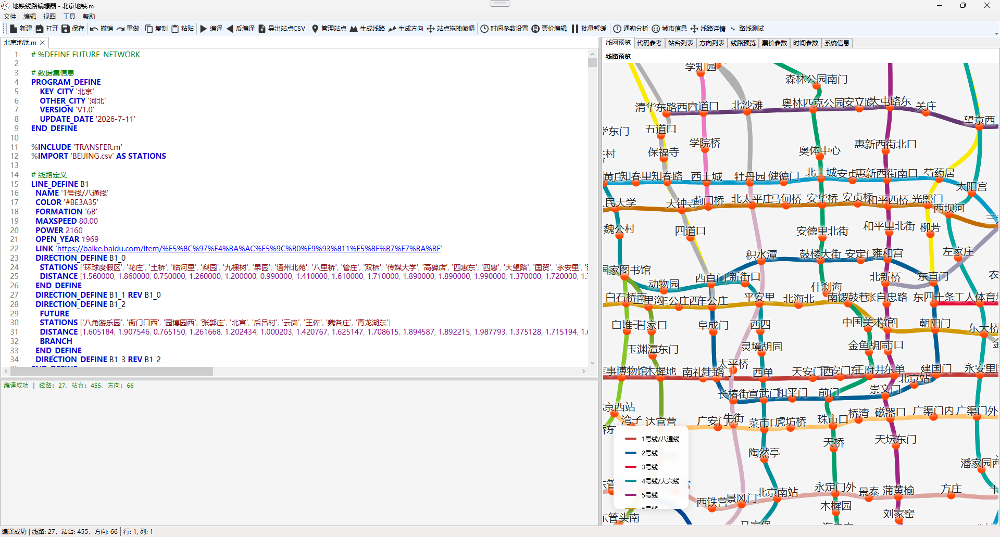
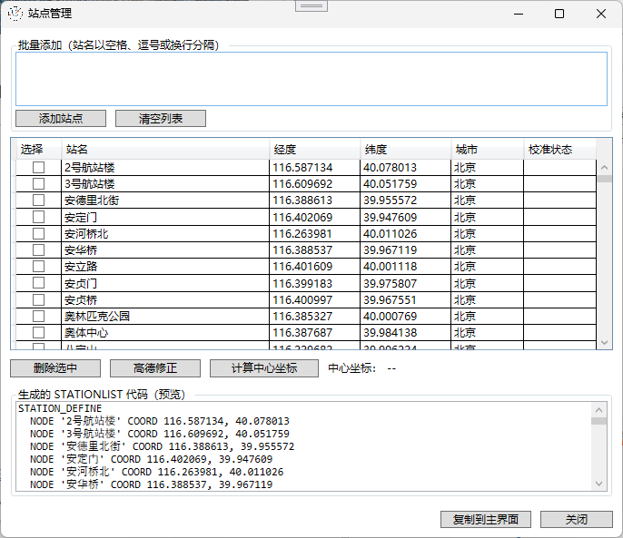
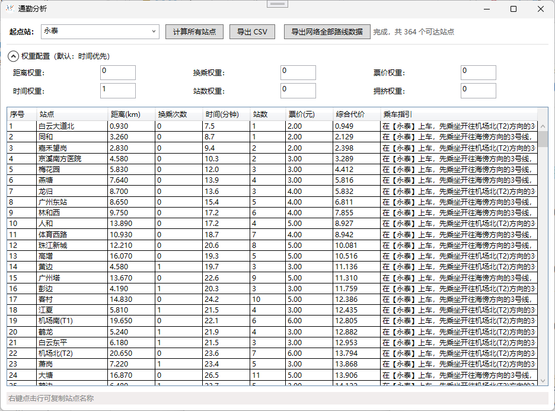
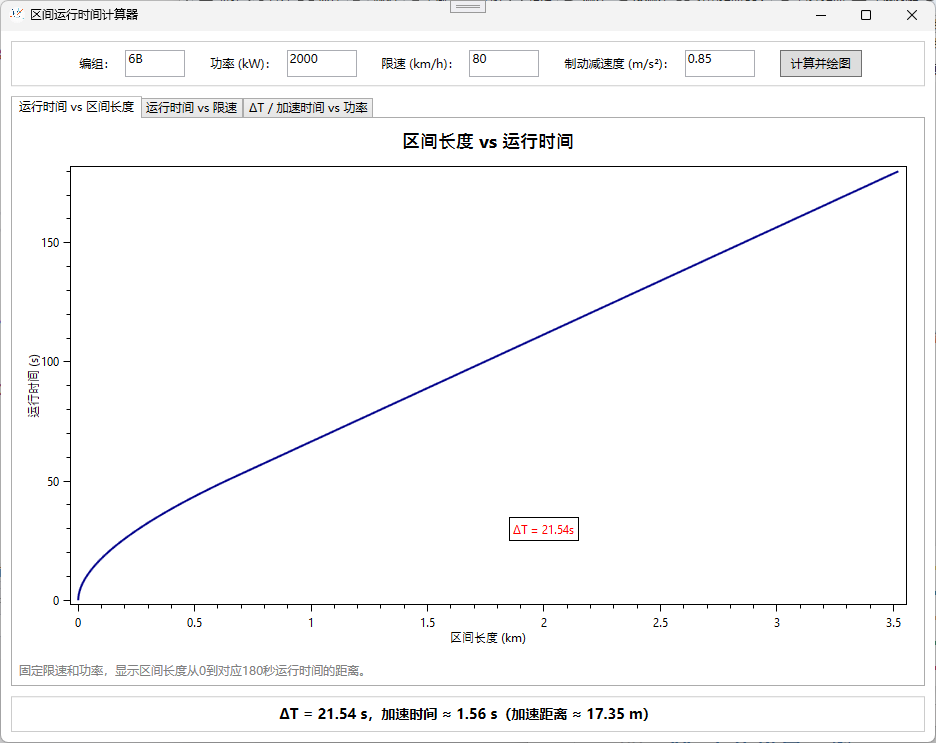

# Metro Editor – 地铁线路编辑器  
  
  

**Metro Editor** 是一款专为地铁线路数据编辑、编译、可视化与分析而设计的桌面工具。它基于 **C# WPF (.NET 8)** 构建，提供了完整的图形化界面，支持从线路定义、站点管理、票价规则到运行参数的全流程编辑，并内置了编译/反编译、地图微调、通勤分析等高级功能。其核心引擎集成了**物理级列车运行时间计算**与**多目标路径规划**，可支撑专业级的城市轨道交通出行分析与路网管理。  

配套的 **Android 客户端**（`Android/` 目录）可与桌面端通过局域网 TCP/UDP 协同工作：一键将编译好的路网推送到手机，实现路线查询、站点打卡、附近站点、历史行程等功能，并支持记录双向同步。  

---

## 主要特性  

### 编辑与编译  
- **多文档编辑**：基于 AvalonEdit 的高亮编辑器，支持 `.metro` 语法高亮，提供撤销/重做、查找/替换等标准编辑功能。  
- **双向编译**：将 `.metro` 文本格式编译为压缩的 `.bmetro` 二进制文件，也可反向反编译为明文 JSON。  
- **嵌入式导出**：将编译后的路网数据导出为专为嵌入式设备设计的 `.bin` 二进制格式（零拷贝、大端序），或生成可直接烧录的 C 语言代码（含完整解析器）。支持多语言站名、预计算区间运行时间，适配 STM32/FreeRTOS 等资源受限平台。  
- **批量处理**：支持批量编译/反编译，一键处理多个文件。  

### 数据管理  
- **站点管理**：可视化添加、删除、批量导入站点，并支持高德地图 API 自动校准坐标。  
- **线路与方向生成**：通过向导式窗口快速生成线路定义（LINE）和方向定义（DIRECTION），并支持预览。  
- **地图微调**：内置简易地图控件，通过拖拽站点进行位置微调，实时更新坐标。  
- **票价与时间参数编辑**：独立窗口管理普通票价、特殊线路票价、换乘规则、停站时间，实时生成配置代码。  

### 分析与可视化  
- **通勤分析**：选择起点站，计算到所有站点的最优路径（距离、换乘、时间、票价、痛苦度），并支持导出 CSV。  
- **城市/线路详情**：查看城市基本信息、线路列表及每条线路的站点详情（含换乘信息）。  
- **路线查询**：独立窗口查询任意两站之间的路径，展示分段详情。  
- **区间运行时间计算器**：基于列车编组、功率、限速等参数，绘制运行时间与区间长度、限速、功率的关系曲线（内置物理模型）。  

### 嵌入式导出  
- **BIN 二进制格式**：紧凑的二进制数据布局，强制大端序，支持零拷贝直接映射到结构体，无需解析，适合 Flash 存储与 OTA 升级。  
- **C 代码生成**：一键生成 `metro_parser.h`、`metro_parser.c` 和 `metro_data.h` 三份文件，包含完整的结构体定义、大端读取宏、Dijkstra 路径规划、票价计算等函数，可直接集成到嵌入式工程中。  
- **多语言站名支持**：站点主名与备用名分离存储，嵌入式端通过语言索引快速获取对应翻译，适配国际/多语言场景。  
- **预计算优化**：区间运行时间和换乘时间在 PC 端预先算好，嵌入式设备只需做整数加法即可完成路径搜索，无需浮点运算或物理模型计算。  
- **工作流整合**：通过主编辑器的“编译并导出”对话框，可在 `.bin` / `.c/.h` / `.bmetro` / `.json` 四种格式间任意选择，一次编译，多端部署。  

### 导入与迁移  
- **OSM 数据导入**：从 OpenStreetMap JSON 数据中提取地铁信息，生成 `.metro` 文件。  
- **语法迁移**：支持将旧版 `.metro` 语法一键迁移到新版块结构（`PROGRAM_DEFINE`、`LINE_DEFINE` 等）。  

### 高级路径规划引擎  
- **多目标优化**：支持距离、换乘次数、票价、时间、站点数的综合权重搜索。  
- **物理级运行时间**：基于戴维斯阻力公式和恒功率牵引模型，精确计算区间运行时间。  
- **拥挤度建模**：引入换乘等待时间的拥挤度惩罚（平均等待趟数模型）。  
- **特殊线路处理**：自动识别机场线、磁悬浮等特殊线路，并应用独立的票价规则。  

### 设备同步与移动端  
- **地图一键推送**：编译当前 `.metro` 文件后，通过 TCP 将 `.bmetro` 数据（GZip 压缩）直接推送到 Android 客户端，手机端即时加载新地图。  
- **UDP 自动搜索设备**：桌面端在局域网内广播发现设备（UDP 端口 28081），手机回复机型名称，确认后自动发起连接，无需手动输入 IP。连接成功后手机端提示“已连接到电脑端”。  
- **记录双向同步**：打卡记录与历史行程可在电脑与手机之间互相同步，自动按“站点/起终点 + 时间戳”去重合并。  
- **记录导出**：手机端记录可导出为 JSON 或 CSV（带 UTF-8 BOM，Excel 可直接打开）；打卡照片会自动解码另存到 `<文件名>_images/` 文件夹。  
- **Android 配套客户端**：路线查询、附近站点（5km 内 GPS 定位，点击快速填入起终点）、站点打卡（相册/拍照配图、备注、日期，支持手动输入站名补打卡）、历史行程管理等。

---

## 界面预览  

> 以下为软件主要界面截图）：  

  
*主编辑器 – 代码编辑区与预览面板*  

  
*站点管理窗口 – 批量添加、坐标校准*  

  
*通勤分析 – 全路网可达性计算与导出*  

  
*区间运行时间计算器 – 物理模型曲线*  

> 更多界面截图请自行编译运行体验。  

---

## 主要窗口一览  

| 窗口类 | 功能描述 |  
|--------|----------|  
| `MainWindow` | 主编辑器，包含代码编辑区、错误列表、预览面板、站台/方向/线路列表等多个标签页。 |  
| `SettingsWindow` | 全局设置：字体大小、字体名称、高德 API Key、路径搜索权重（长度/换乘/票价/时间/站点/特殊票价）。 |  
| `TimeParameterEditorWindow` | 编辑默认时间参数（站内换乘、出站换乘、停站、进站平均时间），自定义换乘规则和停站时间。 |  
| `FareEditorWindow` | 编辑普通票价（起步价、线性扩展、分段票价）和特殊线路票价（统一票价/区间票价）。 |  
| `ManagerStationWindow` | 站点管理：批量添加、删除、高德坐标修正、计算中心坐标，并生成 `STATION_LIST` 代码。 |  
| `EditStationWindow` | 编辑单个站点（站名、经纬度、城市），支持高德校准和复制代码。 |  
| `EditLineWindow` | 生成线路定义（线路 ID、名称、颜色、城市、编组、速度、开通年份、功率、刹车、链接等）。 |  
| `EditDirectionWindow` | 生成/修改方向定义，支持环线/支线/快车/建设中标记，可自由拖拽站点顺序。 |  
| `MapEditorWindow` | 基于 `MetroMapControl` 的地图编辑，通过拖拽调整站点位置，实时预览 `STATION_DEFINE` 代码。 |  
| `CommuteAnalysisWindow` | 通勤分析：选择起点站，计算到所有站点的路径指标，支持导出 CSV。 |  
| `RouteDetailWindow` | 路线查询：输入起点和终点，显示总距离、时间、票价，并以可展开分段列表展示详细路径。 |  
| `CityInfoWindow` | 城市详情：显示城市名、版本、更新日期、总里程、站点/线路数量、票价规则以及线路列表（含颜色、长度、标签等）。 |  
| `LineDetailWindow` | 线路详情：显示线路基本信息（名称、城市、编组、速度、开通年份、长度、标签）以及站点列表（含主线/支线标记）。 |  
| `BatchCompileWindow` | 批量编译：添加文件列表，选择输出格式（.bmetro / .json）和输出目录，批量编译。 |  
| `BatchDecompileWindow` | 批量反编译：添加 `.bmetro` 文件，反编译为 `.json` 输出到指定目录。 |  
| `BatchPendingWindow` | 批量设置暂缓站点：选择线路，勾选站点，生成暂缓代码并复制。 |  
| `OsmImportWindow` | 从 OSM JSON 文件导入地铁数据，生成 `.metro` 预览，可保存。 |  
| `IntervalTimeCalculatorWindow` | 区间运行时间计算器：输入编组、功率、限速、制动减速度，绘制运行时间与区间长度/限速/功率的关系曲线。 |  
| `FindReplaceDialog` | 查找与替换对话框，支持区分大小写、全字匹配。 |  
| `AboutWindow` | 关于对话框，显示版本、版权信息及开源地址。 |  
| `AddSegmentDialog` / `AddSpecialFareDialog` / `AddStopTimeDialog` / `AddTransferDialog` | 各类添加子项对话框。 |  
| `LineSelectorWindow` | 简单线路选择器。 |  
| `InputDialog` | 通用输入对话框。 |  

---

## 快速开始  

### 系统要求  
- 桌面端：Windows 10/11，.NET 8.0 运行时  
- 移动端：Android 12+（minSdk 31），手机与电脑处于同一局域网  

### 运行  
1. 下载已编译的可执行文件（或从源码生成）。  
2. 双击 `MetroEditor.exe` 启动。  
3. 主界面打开后，可通过菜单或工具栏执行各项操作。  

### 基本工作流  
1. **创建/打开文件**：使用“文件”菜单新建或打开 `.metro` 文本文件。  
2. **编辑内容**：在主编辑器中编写或修改线路定义、站点列表、方向等语法。  
3. **编译**：点击“编译”将当前文件编译为 `.bmetro` 二进制文件。  
4. **反编译**：点击“反编译”将 `.bmetro` 文件还原为 JSON 格式。  
5. **管理站点**：通过“站点管理”窗口批量添加站点，校准坐标。  
6. **生成线路/方向**：通过“生成线路”/“生成方向”向导快速生成定义代码。  
7. **设置票价/时间参数**：使用独立编辑器调整票价规则和换乘/停站时间。  
8. **通勤分析**：利用“通勤分析”窗口评估线路通达性。  
9. **地图微调**：使用“站点拖拽微调”在地图上调整站点位置。  
10. **设备同步**：启动同步服务后，自动搜索局域网内的手机设备，推送地图或互相同步记录（详见下节）。  

---

## 设备同步与 Android 客户端  

桌面端通过“设备同步”菜单（`Network/TcpSyncServer.cs` + `Network/UdpDeviceSearcher.cs`）与 `Android/` 目录下的配套客户端协同工作。  

### 同步工作流  
1. **启动服务**：菜单“设备同步 → 启动同步服务”，桌面端开始监听 TCP 端口 28080。  
2. **自动搜索**：菜单“设备同步 → 自动搜索设备”，桌面端在局域网内 UDP 广播发现请求（端口 28081），并列出响应的手机设备（显示机型名称）。  
3. **连接**：选中设备点击“连接此设备”，桌面端下发连接指令，手机端自动回连并提示“已连接到电脑端”。  
4. **推送地图**：菜单“设备同步 → 推送当前地图到设备”，将当前编译好的 `.bmetro`（GZip 压缩）发送到手机，即时生效。  
5. **导出手机记录**：菜单“设备同步 → 导出手机记录”，将手机端的打卡记录与历史行程拉取到电脑，保存为 JSON 或 CSV（打卡照片自动另存为图片文件）。  
6. **推送记录到设备**：菜单“设备同步 → 推送记录到设备”，选择本地 JSON 记录文件，自动识别类型（打卡/行程）后推送到手机，合并去重。  

### Android 客户端功能  
- **路线查询**：基于推送的路网数据（与桌面端同源的多目标路径规划），查询任意两站的最优路径、票价、耗时与换乘。  
- **附近站点**：GPS 定位（WGS-84 自动转 GCJ-02）后列出 5km 内最近地铁站，点击快速填入起点/终点。  
- **站点打卡**：  
  - 附近站点一键打卡，也支持**手动输入站名补打卡**（如在家补打）；  
  - 支持从相册选择或拍照添加打卡照片（自动压缩至 1024px / JPEG 75%）；  
  - 可填写备注与打卡日期。  
- **历史行程**：自动记录每次查询的起终点、里程、耗时、换乘数、票价与途经站点，支持收藏常用路线。  
- **数据同步**：与桌面端双向同步打卡与行程记录，自动去重合并。  

### 同步协议（供二次开发参考）  
- **TCP（端口 28080）**：小端长度前缀帧 `[4 字节 payload 长度][payload]`，payload 首字节为消息类型：  
  `0x01 Hello` / `0x02 Welcome` / `0x03 SyncData`（推送地图）/ `0x04 SyncResult` / `0x05 Ping` / `0x06 Pong` / `0x07 Disconnect` / `0x08 RequestRecords` / `0x09 RecordsData` / `0x0A PushRecords` / `0x0B RecordsResult`。  
- **记录子协议**：`RequestRecords/PushRecords/RecordsData` 载荷为 `[1 字节记录类型][4 字节 JSON 长度][JSON]`，记录类型 1 = 打卡、2 = 历史行程。  
- **UDP（端口 28081）发现协议**：电脑广播 `METRO_DISCOVER_REQ` → 手机单播回复 `METRO_DISCOVER_RSP|<机型>` → 电脑单播 `METRO_CONNECT|<TCP端口>` → 手机自动回连。

---

## 架构概览  

### 核心编译引擎（`MetroLang.Compiler`）  
- **词法分析器（`Lexer`）**：将 `.metro` 源文本分解为 Token 流，支持预处理注释和字符串保护。  
- **语法解析器（`Parser`）**：基于递归下降的语法分析，提供前瞻和错误恢复机制。  
- **命令处理器（`ICommandHandler`）**：每个顶级块（`PROGRAM_DEFINE`、`LINE_DEFINE`、`DIRECTION_DEFINE` 等）均有独立处理器，负责解析子命令并填充编译上下文（`Context`）。  
- **后处理器（`PostProcessor`）**：执行语义优化——去重方向、推断城市归属、展开换乘模板、标记远期车站等。  
- **JSON 导出器（`JsonExport`）**：将 `Context` 映射为标准化的 `JsonRoot` 对象，供前端或 Web 服务使用。  

### 反编译器（`MetroDecompiler`）  
- 将 `JsonRoot` 对象还原为可读的 `.metro` 源码。  
- **智能反向方向识别**：自动检测方向对并输出 `REV` 简写，大幅减少冗余代码。  
- **条件输出**：仅在有自定义数据时生成对应块（如 `DWELL_TIME_DEFINE`）。  

### 路径规划引擎（`PathFinding`）  
- **图构建（`MetroGraph`）**：将路网数据抽象为图结构，节点 = 特定方向上的车站，边 = 运行边或换乘边。  
- **多目标搜索**：改进的 Dijkstra 算法，支持距离、换乘、时间、票价、站点数的加权组合。  
- **物理运行时间（`TrainTimeCalculator`）**：基于戴维斯阻力公式 + 恒功率牵引模型，采用自适应辛普森积分精确计算区间运行时间。  
- **票价计算（`FareCalculator`）**：支持普通里程计费、特殊线路统一票价/分段票价/区间附加费，可处理 `UseLines` 线路组。  
- **换乘等待模型（`TimeCalculator`）**：计算换乘站的候车时间，公式为 `T/2 + t + (C-1)*T`，其中 C 为拥挤度系数。  

### 设备同步（`Network`）  
- **`TcpSyncServer`**：TCP 同步服务端（默认端口 28080），负责设备连接会话管理、地图数据（`.bmetro`）推送以及打卡/行程记录的双向同步。  
- **`UdpDeviceSearcher`**：UDP 局域网设备发现（端口 28081），广播搜索手机设备并向其下发自动连接指令。  

### 移动端（`Android/`）  
- 基于 Java 的配套客户端（包名 `com.embed2026.subway`），实现路线查询、附近站点、站点打卡、历史行程等界面。  
- **`network/TcpSyncClient`**：TCP 同步客户端，实现与桌面端一致的二进制协议。  
- **`network/UdpDiscoveryResponder`**：响应桌面端的 UDP 发现与连接指令。  
- **`data/CheckInManager` / `TripHistoryManager`**：记录本地持久化（SharedPreferences + JSON）、导出与合并去重。  

### 辅助工具（`Tool`）  
- **`MigrationHelper`**：利用“旧源码→编译→JSON→反编译”闭环实现语法迁移。  
- **`MetadataExtractor`**：从路网 JSON 中提取线路静态属性（颜色、编组、速度等）。  
- **`OsmMetroExtractor`**：解析 OSM 数据，自动构建线路方向和站间距。  
- **`MBINExporter` / `CCodeExporter`**：将编译后的路网数据序列化为专为嵌入式环境优化的二进制格式（`.bin`），或生成包含完整解析器的 C 语言代码（`.h`/`.c`），支持多语言站名、预计算区间时间，实现“编译一次，部署到 PC/手机/嵌入式”的跨平台工作流。  

---

## 开发与构建  

### 技术栈  
- **语言**：C#（主程序），**Java**（Android 客户端），**C（嵌入式解析器与导出代码）**  
- **框架**：WPF (.NET 8)  
- **编辑器控件**：AvalonEdit（用于语法高亮和代码编辑）  
- **绘图**：OxyPlot（用于区间计算图表）  
- **地图控件**：自定义 `MetroMapControl`（基于 WebView2 + D3.js 的 SVG 渲染，支持预览/编辑两种模式）  
- **数据序列化**：JSON (System.Text.Json)、二进制压缩 (GZip)  
- **设备同步**：TCP（小端长度前缀帧）+ UDP 局域网发现  
- **嵌入式导出**：C 语言生成 `metro_parser.h/c` 及 `metro_data.h`  

### 构建步骤  
1. 克隆或下载源码。  
2. 使用 Visual Studio 2022+ 打开解决方案（`.sln`）。  
3. 还原 NuGet 包（如有）。  
4. 生成解决方案（`Ctrl+Shift+B`），或命令行 `dotnet build MetroEditor.csproj`。  
5. （可选）Android 客户端：用 Android Studio 打开 `Android/` 目录，连接手机直接运行。  

---

## 文档  

项目附带详细参考文档，位于 `doc/` 目录下，供开发者深入理解数据格式、语言语法、运行时间计算模型及代码架构：  

| 文档 | 说明 |  
|------|------|  
| [`Json格式参考文档.md`](doc/Json格式参考文档.md) | 描述编译生成的 JSON 数据结构的完整字段说明，涵盖站点、线路、票价、运营参数、时段规则、无障碍设施及优惠策略等。 |  
| [`MetroLang参考文档.md`](doc/MetroLang参考文档.md) | MetroLang 领域特定语言的完整语法手册，包含所有命令、块结构、条件编译及示例代码。 |  
| [`列车运行时间计算.md`](doc/列车运行时间计算.md) | 详细推导了基于物理模型的区间运行时间估算方法，包括 Davis 阻力公式、恒功率牵引、制动模型及站台等待时间（含拥挤度）的数学推导与参数说明。 |  
| [`代码架构说明文档.md`](doc/代码架构说明文档.md) | 源码整体架构说明，包括各模块职责、编译流水线与目录组织。 |  

这些文档是理解和扩展本项目的重要参考资料。  

---

### 语法参考（内置）

程序内置了“语法参考”标签页，列出了所有支持的命令及示例。主要包括：

**块定义（`... END_DEFINE`）：**
- `PROGRAM_DEFINE` – 程序元信息（主城市、版本、作者等）
- `STATION_DEFINE` – 站点列表及坐标、别名
- `LINE_TEMPLATE` / `DIRECTION_TEMPLATE` – 线路/方向属性模板（可继承）
- `LINE_DEFINE` – 线路定义（名称、颜色、编组、速度、功率、图片、嵌套方向等）
- `DIRECTION_DEFINE` – 方向定义（站点序列、距离、环线/支线/快车标记、时段拥挤度、发车间隔等）
- `PRICE_DEFINE` – 票价规则（起步价、分段票价、线性扩展、换乘优惠、特殊线路票价）
- `TRANSFER_TYPE` – 换乘类型定义（名称、时间、状态）
- `TRANSFER_DEFINE` – 站点换乘规则（时间、状态、安检）
- `VIRTUAL_TRANSFER_DEFINE` – 虚拟换乘（出站换乘）
- `OPERATION_DEFINE` – 全局运营参数（换乘/停站/出站/进站/上车时间）
- `HEADWAY_PROFILE` – 线路发车间隔时段配置
- `CROWD_PROFILE` – 方向拥挤度系数时段配置
- `DWELL_TIME_DEFINE` – 停站时间定制（按站点、线路、方向）
- `SPEED_LIMIT_DEFINE` – 区间限速定义
- `LABEL_DEFINE` – 地图标签
- `FACILITY_DEFINE` – 无障碍设施、卫生间、电梯等（仅用于展示）
- `PROMOTION_DEFINE` – 票价优惠策略（折扣、一口价、减免）

**单行命令（支持通配符 `*`）：**
- `STATION_COPY` / `STATION_RENAME` / `STATION_DELETE` / `STATION_MODIFY` – 站点操作
- `LINE_COPY` / `LINE_RENAME` / `LINE_DELETE` / `LINE_MERGE` / `LINE_MODIFY` – 线路操作
- `DIRECTION_COPY` / `DIRECTION_RENAME` / `DIRECTION_DELETE` / `DIRECTION_MODIFY` / `DIRECTION_SPLIT` / `DIRECTION_REVERSE` – 方向操作
- `TRANSFER` – 快速换乘规则
- `STATION_MODE` – 站点进出模式（仅进/仅出/正常）
- `OPEN_TIME` – 运营时间（全局或线路）
- `DEPOT` – 车辆段
- `VIA` – 共线/跨线声明
- `STATION_STATUS` – 站点状态（运营/暂缓/出站换乘）
- `ASSERT` – 编译时断言（自定义校验）
- `ECHO` – 输出调试信息

**预处理指令（以 `%` 开头）：**
- `%DEFINE` / `%UNDEFINE` – 定义/取消编译期符号
- `%IF` / `%ELSE` / `%ENDIF` – 条件编译
- `%INCLUDE` – 嵌入外部文件
- `%IMPORT` – 从 CSV 导入站点

更多详细说明请参考软件内置帮助及 `doc/` 目录下的文档。  

---

## 贡献与反馈  

欢迎提交 Issue 或 Pull Request。项目开源地址：[Gitee](https://gitee.com/embed2026/metro_editor)  

---

## 许可证  

本项目采用 **Apache-2.0 许可证**，详情见 LICENSE 文件。